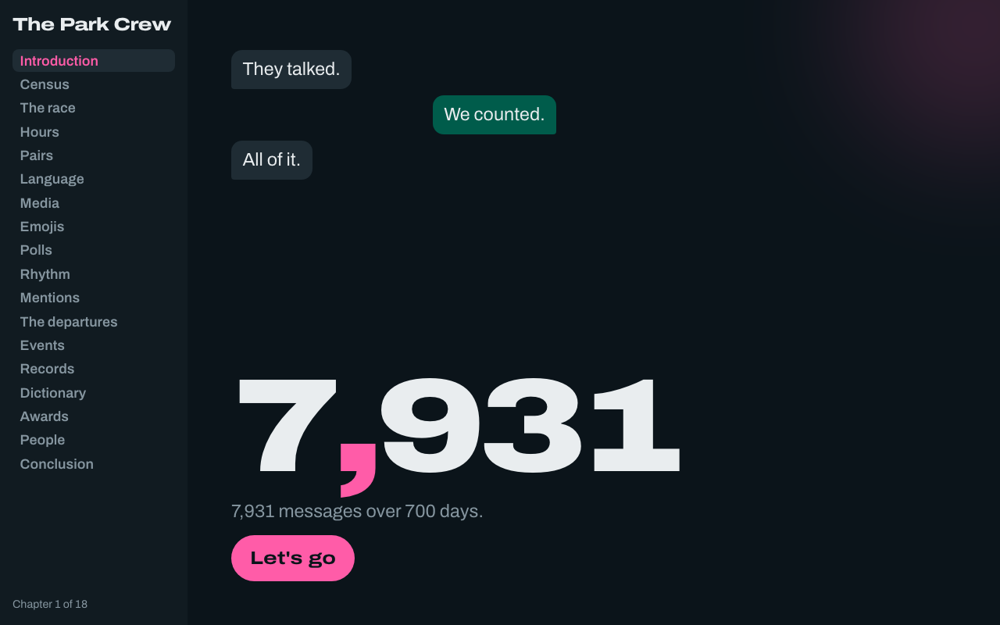
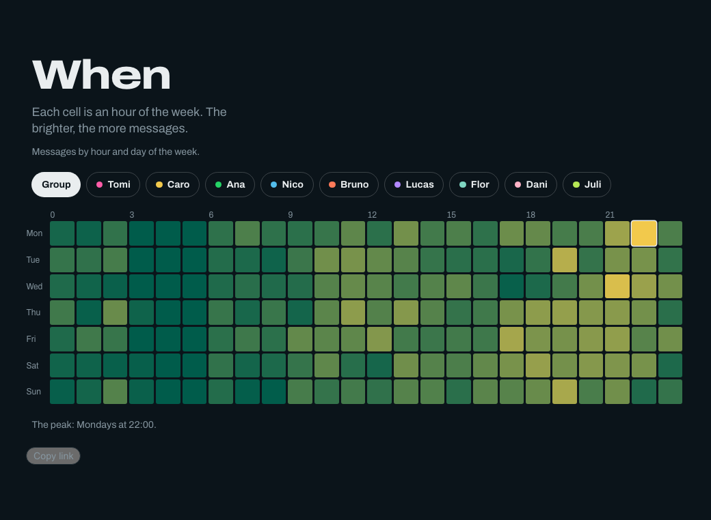
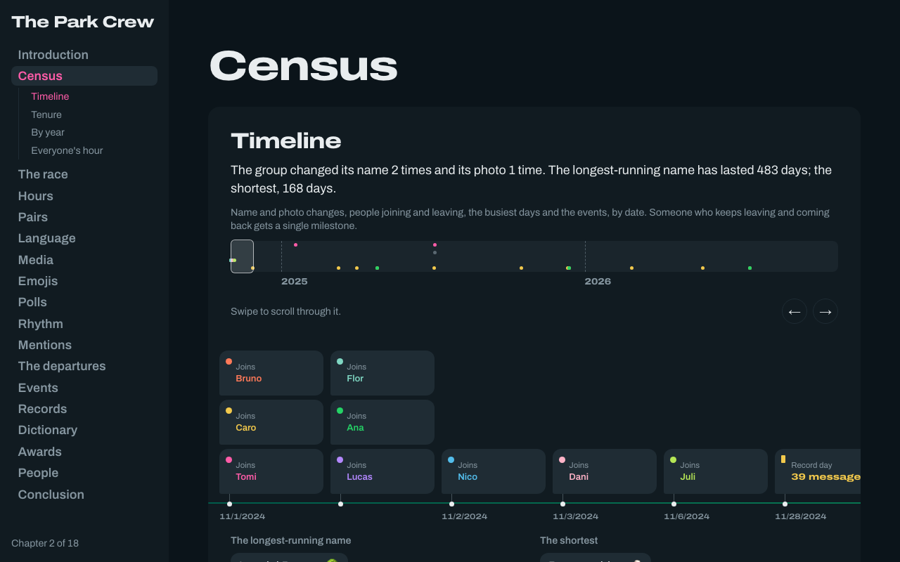
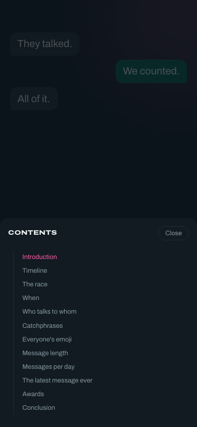
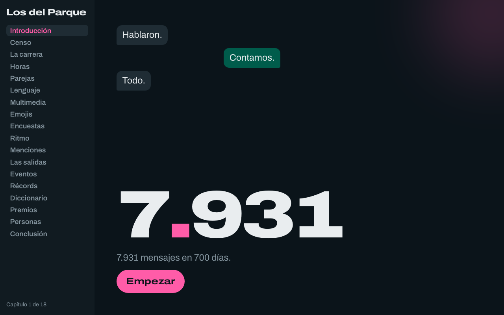
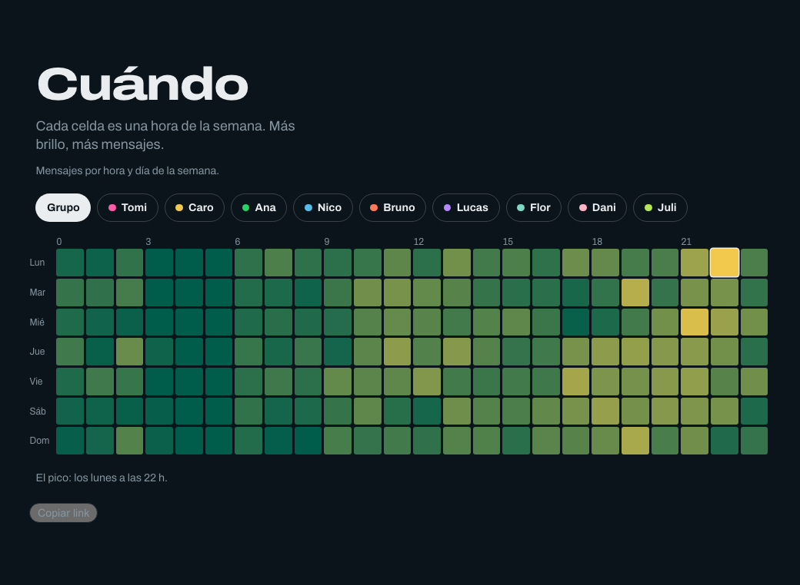
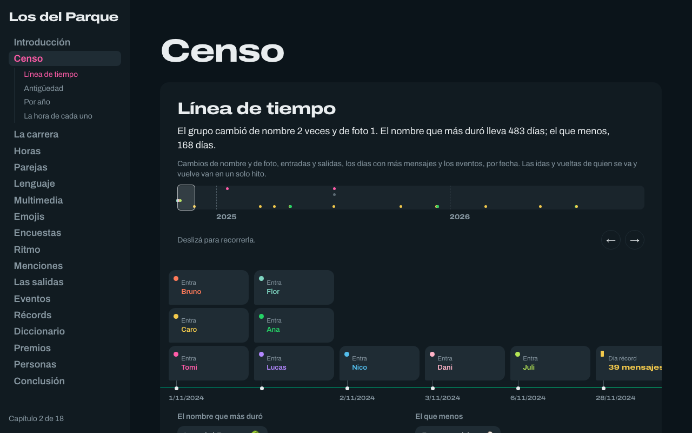
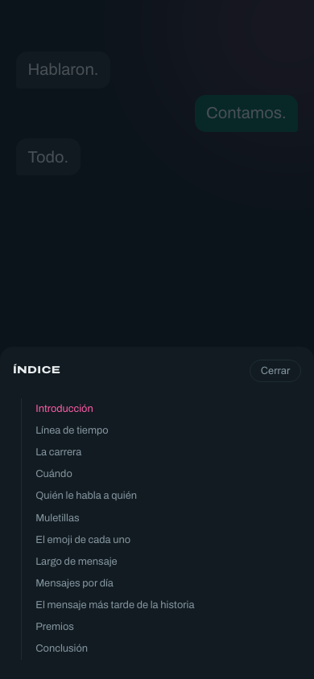

# whatsapp-group-report

[English](#english) · [Español](#español)

## English

### What it is

Turn your WhatsApp group's chat into a website for your friends: who talks most, at what time of day, the group's
own words, its big days and records, and a profile per person. Your AI agent asks you a few questions, writes the
texts in the group's tone and builds the site on your machine. The agent never opens the export: it reads what the
scripts produce (contact names, a sample of the messages, the report's data), which goes to your agent's provider;
the export itself and the finished site stay on your machine unless you publish it.





### Demo

The report of a fictional group, The Park Crew, with no access word (a password for the site):
[whatsapp-group-report-en.vercel.app](https://whatsapp-group-report-en.vercel.app) (in Spanish:
[whatsapp-group-report-es.vercel.app](https://whatsapp-group-report-es.vercel.app)).

### Six steps

You need [uv](https://docs.astral.sh/uv/getting-started/installation/), [Node 22](https://nodejs.org/) with
[pnpm](https://pnpm.io/installation), and an AI agent: [Claude Code](https://code.claude.com/docs),
[Codex](https://developers.openai.com/codex) or [Cursor](https://cursor.com).

**1. Clone the repo and install.**

```bash
git clone https://github.com/Omarch29/whatsapp-group-report.git
cd whatsapp-group-report
uv sync
cd web && pnpm install && cd ..
```

**2. Export the chat and copy it to `chats/`.** On your phone, open the group. On iPhone, tap its name, then
**Export chat** and **Without media**; on Android, tap ⋮ (three dots), then **More**, **Export chat** and
**Without media**. Send the file to your computer. If it arrives as a `.zip`, unzip it and
take the `.txt` inside (on iPhone it is called `_chat.txt`).

```bash
cp ~/Downloads/_chat.txt chats/   # use your file's name and folder (Android names it after the group)
```

**3. Open your agent in the repo folder.**

```bash
claude   # Claude Code; or run codex, or open the folder in Cursor
```

**4. Ask for the report.** Write:

> build the report of my WhatsApp group

(In Claude Code you can also type `/whatsapp-group-report`.) The agent checks your setup, runs the analysis, asks
the questions listed below one at a time with a proposal you can accept with "yes", writes the texts and builds
the site.

**5. Look at it.**

```bash
cd web && pnpm dev
```

Open http://localhost:3000. If you chose an access word, type it first. Then comes the cover and either one long page
with a floating index or chapters with a menu and a profile per person, whichever mode you picked (the agent
recommends the long page for groups with fewer than 20,000 messages or fewer than 5 active people). You can switch
later. If you change something, stop `pnpm dev` and start it
again: it reads the language and the mode once, at start.





**6. Publish it (optional).** The site is a set of static files, so any static host works; this is the path with
Vercel's CLI, from your machine (install it with `npm install -g vercel`). You can also tell the agent "publish it" and it walks you through the
same steps.

```bash
cd web
vercel login
vercel link   # create a new project and give it a name
vercel env add NEXT_PUBLIC_GATE_WORD production --no-sensitive   # only with an access word: type it at the prompt
pnpm run deploy
```

- In the Vercel dashboard (project > Settings > Deployment Protection), keep Vercel Authentication on **Preview**
  deployments only. Production has to open for your friends; the access word guards it.
- `--no-sensitive` lets the deploy read the word back to bake it into the build. Without it the deploy fails.
- If `vercel link` connects your Git repository to the project (or offers to), undo it with `vercel git disconnect`:
  the report is published from your machine, and a connected repository would make Vercel build on every push,
  without your data. `vercel link` also adds a `VERCEL_OIDC_TOKEN` line to `web/.env.local`; leave it there.
- The deploy script is always written `pnpm run deploy`, with `run`: without it pnpm runs a command of its own.
- After any later change, run `pnpm run deploy` again in `web/`.

Send the URL it prints to the group, and tell them the word yourself.

### The questions the agent asks

Each question comes with a proposal taken from the chat. Examples from The Park Crew:

1. **Title.** It lists every name the group has had and proposes the current one, without emoji. *"The Park
   Crew."*
2. **Who you are.** Which contact in the export is you; some exports show your messages as "You". *"I'm
   Ana."*
3. **Short names and nicknames.** A table with each contact, a short name and a nickname; never surnames. A
   `Person N` row is a contact with no usable first name: usually a number that is not in your contacts, sometimes a
   first name that is also someone else's surname. You name them, and one you cannot name may stay as it is. *"Tomi's nickname is Tomate, and Person 3 is Juli."*
4. **Language.** The one most messages are written in; the site and the texts use it. *"English."*
5. **Mode.** One long page, or chapters with a menu and a profile per person, with its recommendation. *"One page
   is fine."*
6. **The one who leaves and comes back.** Asked only if someone left the group and came back at least twice; that
   person gets a chapter. *"Yes, Bruno, he came back three times."*
7. **Access word.** Whether visitors must type a word before seeing anything (recommended for a real chat). The
   agent never asks for the word: you create `web/.env.local` yourself with the single line
   `NEXT_PUBLIC_GATE_WORD=<your word>`. *"Yes, done."*

### Changing things later

Ask the agent in your own words; it edits the file and rebuilds. To do it by hand, these are the files:

| You say | File |
| --- | --- |
| "Change the title to The Park Crew" | `report.config.json`: `title` |
| "Rename the event The barbecue to Bruno's barbecue" | `content/events.json`: that event's `title` |
| "Call Tomi Tomate" | `content/nicknames.json` |
| "Switch it to the full version" | `report.config.json`: `mode` (`single` or `full`) |
| "'damn' is not a swear word for us" | `content/badwords.txt`: one word per line, lowercase, no accents |
| "Make the conclusion shorter" | `content/conclusion.md` |
| "I changed the access word" | `web/.env.local`; if already published, `vercel env rm NEXT_PUBLIC_GATE_WORD production`, `vercel env add NEXT_PUBLIC_GATE_WORD production --no-sensitive` and `pnpm run deploy` in `web/` |

After a change by hand, rebuild the data and restart the site:

```bash
uv run python -I scripts/build_pipeline.py
cd web && pnpm dev
```

Not supported: leaving a person out of the report, hiding a chapter that has data, or adding a new chapter or chart.

### Privacy

- What stays out of git: the export (`chats/`), your content files (`content/`, except the fictional
  `content/example/`), `report.config.json`, `data/`, the generated site data (`web/data/`, except
  `web/data/example/`) and `web/.env.local`. They are ignored on purpose: never force-add them.
- What the agent sees: it never opens the export. It reads what the scripts produce, which includes the full
  contact names (and the numbers that are not in your contacts), a sample of 300 messages, a few lines from the
  busiest days and the report's data, which quotes messages. All of that goes to your agent's provider, like the
  rest of your session.
- Why the word: anyone with the link could read the report. With an access word, visitors type it once and their
  browser remembers it. The word lives only in `web/.env.local` and in your Vercel project's settings.
- The site always carries `noindex`, so search engines do not list it.
- Deploying does not go through git: only the built site (`web/out/`) is uploaded, never the chat, the config or
  `content/`.
- The word keeps casual visitors out; it is not authentication. The pages are static files.

### How it works

- `scripts/` is a Python pipeline with no AI in it: it detects the export format, parses the messages and writes
  one JSON file per chapter into `web/data/`.
- Every count, record and date in the site comes from those scripts.
- `content/` holds what the agent writes: short names, nicknames, events, swear words and the conclusion.
- `report.config.json` holds the title, language, mode, departures chapter and whether there is an access word.
- `web/` is a Next.js site exported as static files; every label exists in English and Spanish.
- The skill in `.agents/skills/whatsapp-group-report/` tells the agent which scripts to run, what to ask and how to
  write the texts.

The design (in Spanish) is in [docs/design.md](docs/design.md); notes for working on the repo are in
[docs/development.md](docs/development.md).

### Limitations

- Groups only, not one-to-one chats.
- Spanish and English only, and one language per report.
- Android exports have no media types (no voice-note counts) and their times are per minute.
- Of the four export formats (iPhone and Android, Spanish and English), only iPhone in Spanish has been checked
  against real exports; the other three are built from documentation. If yours looks wrong, open an issue with 20
  anonymised lines (names and phone numbers replaced, the rest exactly as exported).
- On Windows, Claude Code finds the skill through a symlink: enable symlinks in git before cloning
  (`git clone -c core.symlinks=true ...`; Windows may also ask for Developer Mode or admin rights), or, simpler,
  tell the agent to read `.agents/skills/whatsapp-group-report/SKILL.md`.
- Tested with Claude Code. Codex and Cursor read the same skill and are untested.

## Español

### Qué es

Convertí el chat de tu grupo de WhatsApp en una web para tus amigos: quién habla más, a qué hora, las palabras del
grupo, sus días grandes y sus récords, y un perfil por persona. Tu agente de IA te hace unas preguntas, escribe los
textos con el tono del grupo y arma la web en tu máquina. El agente nunca abre el export: lee lo que generan los
scripts (nombres de contacto, una muestra de los mensajes, los datos del informe), y eso le llega al proveedor de tu
agente; el export y la web terminada quedan en tu máquina salvo que la publiques.





### Demo

El informe de un grupo ficticio, Los del Parque, sin palabra de acceso (una contraseña para la web):
[whatsapp-group-report-es.vercel.app](https://whatsapp-group-report-es.vercel.app) (en inglés:
[whatsapp-group-report-en.vercel.app](https://whatsapp-group-report-en.vercel.app)).

### Seis pasos

Necesitás [uv](https://docs.astral.sh/uv/getting-started/installation/), [Node 22](https://nodejs.org/) con
[pnpm](https://pnpm.io/installation), y un agente de IA: [Claude Code](https://code.claude.com/docs),
[Codex](https://developers.openai.com/codex) o [Cursor](https://cursor.com).

**1. Cloná el repo e instalá.**

```bash
git clone https://github.com/Omarch29/whatsapp-group-report.git
cd whatsapp-group-report
uv sync
cd web && pnpm install && cd ..
```

**2. Exportá el chat y copialo a `chats/`.** En el teléfono abrí el grupo. En iPhone tocá el nombre y después
**Exportar chat** y elegí **Sin archivos**; en Android tocá ⋮ (los tres puntitos), después **Más**, **Exportar chat**
y **Sin archivos**. Mandate el archivo a la compu. Si llega como `.zip`, descomprimilo y quedate
con el `.txt` de adentro (en iPhone se llama `_chat.txt`).

```bash
cp ~/Downloads/_chat.txt chats/   # poné el nombre y la carpeta de tu archivo (Android le pone el nombre del grupo)
```

**3. Abrí tu agente en la carpeta del repo.**

```bash
claude   # Claude Code; o corré codex, o abrí la carpeta en Cursor
```

**4. Pedile el informe.** Escribí:

> armame el informe de mi grupo

(En Claude Code también podés escribir `/whatsapp-group-report`.) El agente revisa que tengas todo, corre el
análisis, te hace las preguntas de abajo de a una, cada una con una propuesta que podés aceptar con un "sí",
escribe los textos y arma la web.

**5. Miralo.**

```bash
cd web && pnpm dev
```

Abrí http://localhost:3000. Si elegiste palabra de acceso, primero la escribís. Después viene la portada y, según
el modo que elegiste, una sola página larga con un índice flotante o capítulos con menú y un perfil por persona (el
agente recomienda la página larga para grupos con menos de 20.000 mensajes o menos de 5 personas activas). Más
adelante podés cambiarlo. Si cambiás algo, pará `pnpm dev` y
volvé a arrancarlo: lee el idioma y el modo una sola vez, al arrancar.





**6. Publicalo (opcional).** La web es un conjunto de archivos estáticos, así que sirve cualquier hosting
estático; este es el camino con la CLI de Vercel, desde tu máquina (se instala con `npm install -g vercel`). También le podés decir al agente "publicalo" y te guía por los
mismos pasos.

```bash
cd web
vercel login
vercel link   # creá un proyecto nuevo y ponele nombre
vercel env add NEXT_PUBLIC_GATE_WORD production --no-sensitive   # solo con palabra de acceso: la escribís cuando te la pide
pnpm run deploy
```

- En el panel de Vercel (proyecto > Settings > Deployment Protection), dejá Vercel Authentication solo en los
  deploys de **Preview**. Producción tiene que quedar abierta para tus amigos; la cuida la palabra de acceso.
- `--no-sensitive` deja que el deploy vuelva a leer la palabra para meterla en el build. Sin eso, el deploy falla.
- Si `vercel link` conecta tu repositorio de Git al proyecto (o te lo ofrece), deshacelo con `vercel git disconnect`:
  el informe se publica desde tu máquina, y con el repositorio conectado Vercel haría un build en cada push, sin
  tus datos. `vercel link` también agrega una línea `VERCEL_OIDC_TOKEN` a `web/.env.local`; dejala ahí.
- El script de deploy siempre se escribe `pnpm run deploy`, con `run`: sin eso pnpm corre un comando propio.
- Después de cualquier cambio, volvé a correr `pnpm run deploy` en `web/`.

Mandale al grupo la URL que imprime, y la palabra pasala vos.

### Las preguntas que hace el agente

Cada pregunta viene con una propuesta sacada del chat. Ejemplos de Los del Parque:

1. **Título.** Te muestra todos los nombres que tuvo el grupo y propone el actual, sin emoji. *"Los del Parque."*
2. **Quién sos.** Cuál de los contactos del export sos vos; en algunos exports tus mensajes aparecen como "Tú".
   *"Soy Ana."*
3. **Nombres cortos y apodos.** Una tabla con cada contacto, un nombre corto y un apodo; apellidos nunca. Una
   fila `Persona N` es un contacto sin un nombre de pila que sirva: casi siempre un número que no tenés agendado, a
   veces un nombre que también es el apellido de otro. Le ponés el nombre vos, y si no sabés quién es puede quedar
   así. *"A Tomi le decimos Tomate, y Persona 3 es
   Juli."*
4. **Idioma.** El de la mayoría de los mensajes; la web y los textos van en ese. *"Castellano."*
5. **Modo.** Una sola página larga, o capítulos con menú y un perfil por persona, con su recomendación. *"Una
   página está bien."*
6. **El que se va y vuelve.** Solo si alguien salió del grupo y volvió al menos dos veces; esa persona tiene su
   capítulo. *"Sí, Bruno, volvió tres veces."*
7. **Palabra de acceso.** Si hay que escribir una palabra antes de ver algo (recomendado para un chat real). El
   agente nunca te pide la palabra: creás vos `web/.env.local` con una sola línea,
   `NEXT_PUBLIC_GATE_WORD=<tu palabra>`. *"Sí, listo."*

### Cambiar cosas después

Pedíselo al agente como te salga; él edita el archivo y vuelve a armar todo. Si preferís hacerlo a mano, estos
son los archivos:

| Le decís | Archivo |
| --- | --- |
| "Cambiá el título a Los del Parque" | `report.config.json`: `title` |
| "Cambiá el título del evento El asado a El asado de Bruno" | `content/events.json`: el `title` de ese evento |
| "A Tomi decile Tomate" | `content/nicknames.json` |
| "Pasalo a la versión completa" | `report.config.json`: `mode` (`single` o `full`) |
| "'boludo' no cuenta como puteada" | `content/badwords.txt`: una palabra por línea, en minúsculas y sin tildes |
| "Hacé más corta la conclusión" | `content/conclusion.md` |
| "Cambié la palabra de acceso" | `web/.env.local`; si ya está publicada, `vercel env rm NEXT_PUBLIC_GATE_WORD production`, `vercel env add NEXT_PUBLIC_GATE_WORD production --no-sensitive` y `pnpm run deploy` en `web/` |

Después de un cambio a mano, regenerá los datos y reiniciá la web:

```bash
uv run python -I scripts/build_pipeline.py
cd web && pnpm dev
```

No se puede: dejar a alguien afuera del informe, esconder un capítulo que tiene datos, ni agregar capítulos o
gráficos nuevos.

### Privacidad

- Qué queda fuera de git: el export (`chats/`), tus archivos de contenido (`content/`, salvo el ficticio
  `content/example/`), `report.config.json`, `data/`, los datos generados de la web (`web/data/`, salvo
  `web/data/example/`) y `web/.env.local`. Están ignorados a propósito: nunca los agregues con `git add -f`.
- Qué ve el agente: nunca abre el export. Lee lo que generan los scripts, que incluye los nombres de contacto
  completos (y los números que no tenés agendados), una muestra de 300 mensajes, algunas líneas de los días con más
  movimiento y los datos del informe, que citan mensajes. Todo eso le llega al proveedor de tu agente, como el resto
  de la sesión.
- Por qué la palabra: cualquiera con el link podría leer el informe. Con palabra de acceso, cada visitante la
  escribe una vez y queda guardada en el navegador. La palabra vive solo en `web/.env.local` y en la configuración de tu
  proyecto en Vercel.
- La web siempre lleva `noindex`, así no aparece en los buscadores.
- El deploy no pasa por git: solo se sube la web armada (`web/out/`), nunca el chat, el config ni `content/`.
- La palabra frena a los curiosos; no es autenticación. Las páginas son archivos estáticos.

### Cómo funciona

- `scripts/` es un pipeline en Python sin IA: detecta el formato del export, lee los mensajes y escribe un JSON por
  capítulo en `web/data/`.
- Cada número, récord y fecha de la web sale de esos scripts.
- `content/` tiene lo que escribe el agente: nombres cortos, apodos, eventos, puteadas y la conclusión.
- `report.config.json` tiene el título, el idioma, el modo, el capítulo del que se va y vuelve, y si hay palabra
  de acceso.
- `web/` es una web en Next.js exportada como archivos estáticos; cada etiqueta existe en castellano y en inglés.
- La skill de `.agents/skills/whatsapp-group-report/` le dice al agente qué scripts correr, qué preguntar y cómo
  escribir los textos.

El diseño está en [docs/design.md](docs/design.md); las notas para trabajar en el repo (en inglés), en
[docs/development.md](docs/development.md).

### Limitaciones

- Solo grupos, no chats de a dos.
- Solo castellano e inglés, y un idioma por informe.
- Los exports de Android no traen el tipo de cada archivo (no hay conteo de audios) y sus horas van por minuto.
- De los cuatro formatos de export (iPhone y Android, castellano e inglés), solo iPhone en castellano está probado
  con exports reales; los otros tres están armados a partir de documentación. Si el tuyo se ve raro, abrí un issue
  con 20 líneas anonimizadas (nombres y teléfonos reemplazados, el resto tal cual salió).
- En Windows, Claude Code encuentra la skill por un symlink: activá los symlinks en git antes de clonar
  (`git clone -c core.symlinks=true ...`; Windows puede pedir además el modo de desarrollador o permisos de
  administrador), o, más simple, decile al agente que lea `.agents/skills/whatsapp-group-report/SKILL.md`.
- Probado con Claude Code. Codex y Cursor leen la misma skill y no están probados.
